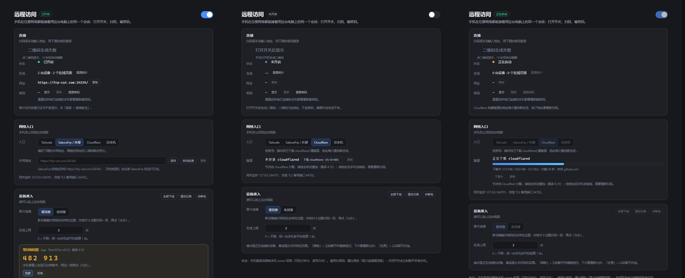

# DSH Mobile Harness

<p align="center">
  <b>把电脑上的 DeepSeek Harness，装进你的手机。</b><br/>
  扫码即连 · 浏览器就能用（App 可选）· 四条网络入口 · 设备逐台准入
</p>

<p align="center">
  <a href="https://www.npmjs.com/package/dsh-mobile-harness"></a>
  
  
  
</p>



> 电脑端面板：一个总开关，下面三张卡——连接 / 网络入口 / 设备准入。左：开着；中：关着；右：Cloudflare 隧道正在下载、建立。

---

## 这是什么

DSH Mobile Harness 给 DSH 加一页「远程访问」：一个网关、一个密码、一张二维码、四条网络入口、一套设备准入。手机用**浏览器**或**可选的 App** 连上来，接着用电脑上那个会话。

| 部分 | 是什么 | 必需吗 |
| --- | --- | --- |
| **插件** | 在 DSH 里加一页「远程访问」：网关、密码、二维码、隧道、设备准入 | 必需 |
| **App** | 4 MB 的 Android 壳：相机扫码、记住密码、下载落盘 | 可选 |

**手机不一定需要 App。** 任何浏览器（Safari / Chrome / 微信内置也行）扫一下面板上的二维码、输一次密码，就能接着用电脑上的同一个会话；App 只是把这段流程做得更顺。两条路走的是同一个网关、同一套准入，扫码一样要核对 6 位配对码。

不是另开一个账号，是**同一台电脑、同一个会话**：上下文、工具、文件都还是电脑上那份。

## 功能

### 电脑端面板

- **连接卡**：二维码（一次性登录链接，10 分钟有效，扫一次失效；默认模糊，点开显示，10 秒后自动模糊）+ 状态 + 在线统计（按「设备 + 页面」）+ 网址 + 密码（显示 / 复制 / 重置）+ 验证开关。
- **网络入口卡**：四种入口一键切换。日常推荐**外部隧道**或 **Cloudflare**；Tailscale 也能用，但走中继时延迟偏高（见下文）。Cloudflare 免账号，一键下载 cloudflared（带进度条、速度、剩余时间）并自动建立 quick tunnel；SakuraFrp 可手填外网地址，也能从运行日志自动检测。
- **设备准入卡**：首次连接「需同意 / 免同意」、在线上限（0 = 不限，同手机多开算 1 台）、待同意队列、设备列表（在线绿点置顶、离线灰灯）、移除 / 拉黑 / 解除，「全部下线」「清空记录」「诊断包」。
- 开关、密码、设备信任、隧道选择全部持久化，DSH 重启后自动恢复。

### 手机端

- **浏览器（不用装东西）**：扫码或手输地址 + 密码即可进入，窄屏皮肤自动生效。
- **App（可选）**：相机扫码取景框自动识别（也可从相册选图）、四个入口 chip、密码按地址记住、密码错了自动清掉并提示重填、下载钩子（电脑上点「下载」直接落到手机）。

### 安全

- 网关只监听 `127.0.0.1`，不监听 `0.0.0.0`、不做端口映射。
- 三层准入：密码 → 6 位配对码两端核对 → 设备白名单。
- **扫码不等于放行**：扫完落地的是等待页，页面上那串配对码要和你电脑面板上的一致，点了「允许」才真正进站。
- 移除 = 立刻断开 + 撤销信任，下次要重新配对；拉黑 = 永久拒绝。
- 诊断包是白名单字段，不含密码、session、设备 token。细节见 [SECURITY.md](SECURITY.md)。

## 快速开始

### 0. 你需要

- 一台跑着 DSH 的电脑（Windows / macOS / Linux；本项目在 Windows 11 上开发与实测）
- DSH ≥ 0.2.1-rc.3，Node ≥ 22
- 一个浏览器（手机、平板、另一台电脑都行）；想用相机扫码再准备一台 Android 8.0+

### 1. 装插件

**方式 A：npm（最快）**

```bash
dsh plugin --profile desktop add dsh-mobile-harness
```

**方式 B：一键脚本（从仓库）**

```bash
git clone https://github.com/afeack/dsh-mobile-harness.git
cd dsh-mobile-harness
node scripts/install-plugin.mjs --profile desktop   # 换成你的 profile 名字
cd ~/.dsh/profiles/desktop && pnpm install
```

脚本会往 profile 的 `package.json` 里写一条依赖和一个 bundle 条目，重复跑是幂等的。

**方式 C：手动改 profile**

profile 在 `~/.dsh/profiles/<名字>`（Windows 是 `%USERPROFILE%\.dsh\profiles\<名字>`），改两处：

```json
{
  "dependencies": {
    "dsh-mobile-harness": "1.0.0"
  },
  "dsh": { "profile": { "bundles": ["...", "dsh-mobile-harness"] } }
}
```

`dsh.profile.bundles` 里必须有包名，否则 DSH 不会去加载它。改完在 profile 目录里 `pnpm install`。

### 2. 重启 DSH

退出托盘图标，重新打开。会话侧栏会出现「远程」入口，点进去是「远程访问」面板。

### 3. 打开开关

面板右上角把总开关打开，再选一个网络入口（见下一节），拿到网址。

### 4. 手机接入

**A. 浏览器（先试这个）**

1. 手机浏览器打开面板上的网址，或者直接扫面板上的二维码。
2. 浏览器停在等待页，页面上有一串 6 位配对码。
3. 电脑面板「设备准入」里出现同一串数字 —— 核对一致，点「允许」，再点「数字一致，允许」。
4. 手机上自动进站，之后直接刷新就能继续用。

**B. 装 App（可选）**

1. 装 [Releases](https://github.com/afeack/dsh-mobile-harness/releases) 里的 `dsh-mobile-harness-1.0.0.apk`（或仓库里的 `app/dist/dsh-mobile-harness-1.0.0.apk`）。
2. 打开 App → 相机扫码（或从相册选图）→ 同样核对 6 位配对码。
3. 勾「记住地址和密码」，以后换地址也能自动填。

## 四个入口怎么选

| 入口 | 推荐度 | 要准备什么 | 说明 |
| --- | --- | --- | --- |
| **SakuraFrp / 任意外部隧道** | ✅ **推荐** | 已有一条 frp 隧道，填外网地址（如 `https://frp-cat.com:12345/`） | 地址稳定，延迟低；「自动检测」会去读 SakuraFrp 的运行日志 |
| **Cloudflare 快速隧道** | ✅ **推荐（零准备）** | 什么都不用 | 免账号、一键建隧道；地址每次重启都变，换地址要重新扫码；首次要下约 50 MB 的 cloudflared |
| **仅本机** | ✅ 局域网内 | 手机和电脑同一个 Wi-Fi | 最安全，出了局域网连不上 |
| **Tailscale** | ⚠️ **不推荐** | 两端都装 Tailscale、登录同一账号 | 能穿透 NAT，但流量常走 DERP 中继，延迟明显偏高；只在内网直连（同一局域网 / 同一 VPC）时才顺 |

**为什么 Tailscale 排最后**：它解决的是「没有公网入口也能连上」，代价是节点绕行——手机到电脑可能先绕到境外中继再回来，打字、翻页都能感觉到卡。**有公网入口就用外部隧道，没有就开 Cloudflare**；Tailscale 留给「内网直连 + 不想开公网」的场景。

第一次接入建议先用「仅本机」把扫码和配对码跑通，再切到公网入口。

## 常见问题

**一定要装 App 吗？**
不用。浏览器扫码就能用，App 只是把相机扫码、密码记忆、下载落盘这几件事做得更顺。

**手机上一直转圈 / 打不开？**
先确认入口选对了，地址带不带尾斜杠都试试；公网入口要等隧道状态变成「已连接」。自签证书（64702 端口）第一次会提示不受信任，点「高级 → 继续前往」。

**扫码后停在「等待同意」？**
这是设计。去电脑面板「设备准入」，核对那串 6 位数字，一致再点「允许」。

**忘了网关密码？**
面板上「重置密码」。重置后所有已连接设备都要重新输密码。

**面板里找不到「远程」？**
插件没装好或 DSH 没重启。检查 profile 的 `package.json` 里有没有依赖和 bundle 条目，然后重启。

**Cloudflare 下载失败？**
插件会依次试 8 个地址（官方 + 7 个镜像），全都不通才会报错。三条退路，任选一条：

1. **自己的镜像**：设环境变量 `DSH_CLOUDFLARED_URL` 指向你能连的地址，下次点下载会先试它。
2. **手动放置**：下载 [cloudflared-windows-amd64.exe](https://github.com/cloudflare/cloudflared/releases/latest/download/cloudflared-windows-amd64.exe)，改名 `cloudflared.exe`，放到 `~/.dsh/remote-access/bin/`（Windows 是 `C:\Users\<你>\.dsh\remote-access\bin\`），面板会显示「程序已就绪」。
3. **本来就有**：只要 `PATH` 里能找到 `cloudflared`，插件直接用它，不再下载。

下载卡住时面板上有「停止下载」；下坏了（文件损坏、下到一半）用「删除」（点两次确认），删掉重下即可。

**电脑重启后手机连不上了？**
Cloudflare 快速隧道每次重启都会换地址，重新扫码即可；外部隧道和 Tailscale 的地址是稳定的。

**能同时连几台？**
「在线上限」控制，默认 3，0 表示不限。同一台手机开多个页面算 1 台。

**密码、二维码会不会被写进日志？**
诊断包是白名单导出，不含密码与 token；面板上的二维码只含一次性票据，不含密码。

## 目录结构

```
plugins/dsh-mobile-harness/     插件：网关、准入、二维码、隧道、面板 UI
  lib/proxy.js             网关（Cookie、会话、扫码票据、等待页）
  lib/registry.js          设备与信任、待同意队列、配对码
  lib/service.js           开关、快照、诊断包
  lib/cloudflared.js       Cloudflare quick tunnel
  lib/tailscale.js         Tailscale 探测
  lib/phone-tool.js        手机协助（读屏 / 点按）
  lib/client.js            面板 UI（React）
app/                       Android 客户端（Capacitor 6，可选）
  www/index.html           登录页、扫码、手机协助
  android/app/src/main/java/com/dsh/remote/   原生桥、轮询、无障碍服务
scripts/install-plugin.mjs 安装脚本
assets/                    README 截图
```

## 从源码构建

插件是纯 ESM，不需要编译：

```bash
node --check plugins/dsh-mobile-harness/lib/*.js
```

App 需要 JDK 17 + Android SDK 34：

```bash
cd app
npm install
npx cap sync android
cd android
ANDROID_HOME=<你的 SDK> JAVA_HOME=<你的 JDK17> ./gradlew assembleDebug
# 产物：app/build/outputs/apk/debug/app-debug.apk
```

## 状态与路线图

- **1.0.0（2026-10-31）**：四条入口、扫码 + 配对码、设备准入、下载钩子；浏览器与 App 两条路都能用。
- **手机协助（P2）**：读屏、点按、输入、滚动、开 App 都已实现，但界面在 1.0 里默认隐藏，等验收后再放出来。需要系统无障碍服务；支付 / 银行 / 系统设置类界面一律拒绝。
- **P3**：通知、音量、勿扰、手电、亮度、深链打开 App。

## 开发笔记

开发过程中的中文记录（交接指南、设备准入实施计划、验收清单）目前还留在本地，没进这个仓库——里面混着本机路径和真实的隧道地址，需要先脱敏。等清理完会作为 `docs/` 补进来；在那之前，代码和本 README 是唯一准绳。

## 致谢

- [DeepSeek Harness](https://github.com/deepseek-ai)：宿主。
- [jsQR](https://github.com/cozmo/jsQR)、[Capacitor](https://capacitorjs.com/)、[cloudflared](https://github.com/cloudflare/cloudflared)。

## License

[MIT](LICENSE)。第三方组件许可见 [THIRD-PARTY-NOTICES.md](THIRD-PARTY-NOTICES.md)。

---

## English

**DSH Mobile Harness** brings your desktop [DeepSeek Harness](https://github.com/deepseek-ai) session to your phone. A DSH plugin adds a gateway with a password, a one-time QR ticket, four network entries and per-device admission control.

**No app required.** Any browser can scan the QR code, type the password, and continue the same desktop session. The 4 MB Android app is optional: camera scanning, remembered passwords, download-to-phone.

- Four network entries: external tunnel (SakuraFrp) and Cloudflare quick tunnel are recommended; LAN-only for local use; Tailscale works but usually relays traffic and adds latency.
- Pairing: password → 6-digit code shown on both ends → device allow-list. Scanning a QR never grants access by itself.
- Admission control: online limit, pending queue, remove / block devices, kick-all.

Install (plugin):

```bash
dsh plugin --profile desktop add dsh-mobile-harness
# or from source:
git clone https://github.com/afeack/dsh-mobile-harness.git
cd dsh-mobile-harness
node scripts/install-plugin.mjs --profile desktop
cd ~/.dsh/profiles/desktop && pnpm install
```

APK: the [Releases](https://github.com/afeack/dsh-mobile-harness/releases) page. License: MIT. See [SECURITY.md](SECURITY.md) before exposing the gateway to the public internet.
