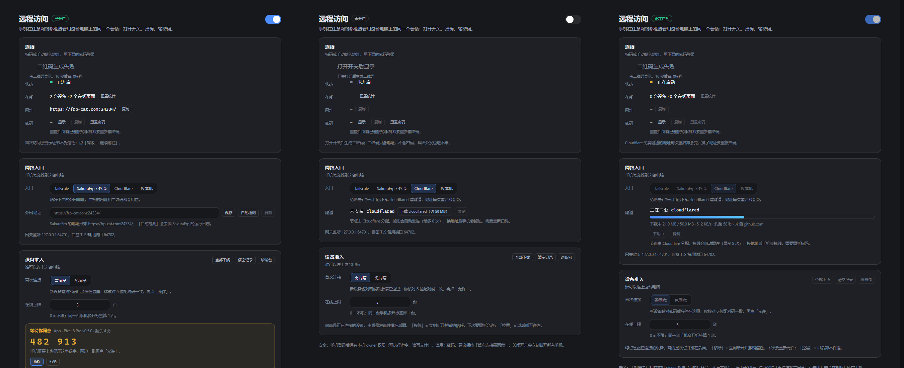

# DSH Mobile Harness

> 本 Fork 当前源码的插件版本为 `1.2.0`，继承 `1.1.0` 安全修复并加入 Mobile Web UI 2.0；Android App 源码版本为 `1.0.1`。请从当前源码安装或构建；下方上游 npm、release 和仓库内历史 APK 的旧版本未包含这些 Fork 修复。首次升级后应在电脑本机重置密码并重新配对。详见 [安全说明](SECURITY.md)。

<p align="center">
  <b>把电脑上的 DeepSeek Harness，装进你的手机。</b><br/>
  扫码即连 · 浏览器就能用（App 可选）· 五个网络入口（含局域网 / 虚拟组网）· 设备逐台准入 · 一键自检
</p>

<p align="center">
  <a href="https://www.npmjs.com/package/dsh-mobile-harness"></a>
  
  
  
</p>



> 电脑端面板：一个总开关，下面是顶部分栏——连接与设备 / 文件传输 / 界面，最右侧显示版本与更新提示。

**下载**：npm dsh-mobile-harness

---

## DSH 0.2.2-rc.1 兼容

当前源码已按宿主版本分流：新版保留官方手机 / 平板 UI，旧版继续使用插件折叠屏皮肤；远程服务支持真实 HTTP(S) / IPv6 上游，并补齐外部 link 安装的宿主 peer。实现与升级后清单见 [兼容性报告](COMPATIBILITY-0.2.2-rc.1.md)。

## 功能

为DSH添加了远程控制功能，仅需使用浏览器，扫码即可体验随走随身的DSH。
在您不满足于网页版的体验时，可以选择下载我们的APK我们会不断更新我们的安卓客户端。
担心被别人连接电脑？不用担心，首次授权确认+设备管理+随机密码，保护您的连接安全。
- 我们提供五种入口，适用于不同人群:
- ①cloudflare(免注册、免费、最省事、代价是每次重启DSH需要重新扫码登录)
- ②外部隧道(内网穿透、需注册、可能付费、需实名，但好处是最稳定且重启DSH后保留原本的登录，无需再次扫码)
- ③Tailscale(手机电脑需额外软件，数据走的境外服务器，延迟高，不推荐，需注册)
- ④LAN（使用 HTTP 直连，适合可信局域网或虚拟组网）
- ⑤仅本机(只监听 127.0.0.1，用于本机访问，手机连不上)

**手机不一定需要 App。** 使用浏览器(最好使用chrome)扫一下面板上的二维码、确认一次，就能接着用电脑上的同一个DSH。

***APK仍在开发，可能会有严重的兼容性问题，所以暂不推荐***

！！***请注意对于部分手机用户，例如红米/小米等，由于其系统的特殊性不推荐使用手机自带浏览器进行访问，实测QQ浏览器以及firefox、chrome都可以替代***！！

不是另开一个账号，是**同一台电脑、同一个会话**：上下文、工具、文件都还是电脑上那份。

### 文件传输

面板顶部有「文件传输」一栏：手机和电脑读写**同一个文件夹**，不用发微信、不用连数据线。

- 电脑上把文件拖进虚线框，或点一下选文件；手机上同理（相册、文档、压缩包都行）。
- 列表里可以「下载」到本机，也可以「删除」；同名文件自动加 `（1）`，绝不覆盖。
- 单个上限 200 MB（DSH 的网关本身允许 300 MB，留了余量）。
- 存放位置默认在插件自己的数据目录：`%USERPROFILE%\.dsh\remote-access\files`。
- **位置可以改**：点「选择…」在文件管理器里挑一个文件夹（也可以直接填路径，比如 `E:\共享`、同步盘），点「保存」即生效；清空就回到默认。换位置**不会搬运**旧文件。

### 电脑端 / 远程端

同一个页面，两种身份，控件会自动分开：

- **电脑本机**（直接开 DSH 面板）：开关、网络入口、一键自检、设备准入、界面模式（默认档 + 每台设备可单独覆盖）、文件池位置全都在。
- **手机 / 远程页面**（经网关转发进来的）：只留「文件传输」，其余本机设置一律隐藏；顶部一行说明告诉你为什么看不到。

判断依据是「请求有没有经过网关」，不是 IP —— 所以皎月连、SakuraFrp 那种从本机 127.0.0.1 转发进来的访问也会被正确认成远程端。

### 网络流量

网关对 JSON / JS / CSS / HTML 等文本响应按 `Accept-Encoding` 压 Brotli 或 gzip，静态资源继续走 immutable 缓存；`/plugins/events` 是 SSE，不再被误标为长缓存，并会按页面 boot revision 跳过重复的初始 graph。审批浮层改走 15 秒的轻量 `/pending` 长轮询，状态接口带 ETag/304，手机空闲时基本不产生正文流量。

真机实测：冷启动 17.8 MB → 3.47 MB（-80.5%），`/api/session/list` 955 KB → 98 KB，空闲审批轮询从约 12 MB/小时降到接近 0。实现细节、实测方法和仍建议上游 DSH 修改的部分见 [网络传输优化](NETWORK-PERFORMANCE.md)。

### 安全

- 默认和隧道入口下，网关只监听 `127.0.0.1`，由用户选择的隧道提供远程 HTTPS。局域网入口允许内网 IPv4 客户端使用明文 HTTP，仅适合可信网络，请勿将端口转发到公网。
- 三层准入：密码 → 6 位配对码两端核对 → 设备白名单。
- **扫码不等于放行**：扫完落地的是等待页，页面上那串配对码要和你电脑或其他已信任设备上弹出的一致，点了「允许」才真正进站。
- 移除 = 立刻断开 + 撤销信任，下次要重新配对；拉黑 = 永久拒绝。
- 诊断包是白名单字段，不含密码、session、设备 token。细节见 [SECURITY.md](SECURITY.md)。

## 快速开始

### 0. 你需要

- 一台跑着 DSH 的电脑（Windows Desktop / macOS Desktop，或 Linux Web）
- DSH ≥ 0.2.1-rc.3。Desktop 自带 Host 运行时；从命令行打包或运行测试需要 Node ≥ 22。
- 一个浏览器（手机、平板、另一台电脑都行）；想用相机扫码再准备一台 Android 8.0+

### 1. 装插件

在 Windows PowerShell 中，克隆本 Fork（已有检出可跳过前两行），取得插件目录的绝对路径：

```powershell
git clone https://github.com/RoyShen12/dsh-mobile-harness.git
Set-Location .\dsh-mobile-harness
(Resolve-Path -LiteralPath .\plugins\dsh-mobile-harness).Path
```

在 **DSH Desktop → 插件 → 添加插件** 粘贴最后一行输出的路径。路径中有空格或中文时，直接粘贴，无需添加引号。macOS 用同一界面安装该目录；已检出的源码可用 `printf '%s\n' "$PWD/plugins/dsh-mobile-harness"` 取得路径。插件无需预先构建。若要把包转到另一台电脑，在 `plugins/dsh-mobile-harness` 目录执行 `npm pack`，然后在目标电脑的「添加插件」粘贴该 `.tgz` 的绝对路径。

### 2. 确认插件已启用

按插件管理器的安装结果操作；只有它提示需要重启时，才退出并重新打开 Desktop。会话侧栏或「更多」中会出现「远程」入口。

### 3. 选择你的方式、打开开关

面板右上角把总开关打开，再选一个网络入口（见下一节），拿到网址。

### 4. 手机接入

> **小米 / 红米等用户注意**：系统自带浏览器和部分定制 WebView 会把页面里的点击同步拦掉，表现为「按钮点不到、界面不同步」。换 **QQ 浏览器** 或 **Chrome** 打开同一网址即可，插件本身不用改。


**A. 浏览器（先试这个）**

1. 手机浏览器打开面板上的网址，或者直接扫面板上的二维码。
2. 浏览器停在等待页，页面上有一串 6 位配对码。
3. 电脑面板「设备准入」里出现同一串数字 —— 核对一致，点「允许」，再点「数字一致，允许」。
4. 手机上自动进站，之后直接刷新就能继续用。
5. **安装到主屏幕（PWA）**：使用 HTTPS 地址，在「远程 → 连接与设备 / 界面」点击「安装到主屏幕」，或使用浏览器菜单的「安装应用 / 添加到主屏幕」。iPhone / iPad 用 Safari 的「分享 → 添加到主屏幕」。从主屏幕打开是独立窗口，仍需联网且电脑上的 DSH 保持运行。更换域名或端口后从新地址重新添加；系统若使用独立存储，首次启动按提示重新登录配对。详见 [PWA 说明](plugins/dsh-mobile-harness/README.md#安装到主屏幕pwa)。

**B. 装 App（不推荐）**

1. 装 [App 1.0.0 release](https://github.com/afeack/dsh-mobile-harness/releases/tag/v1.0.0) 里的 `dsh-mobile-harness-1.0.0.apk`（或仓库里的 `app/dist/dsh-mobile-harness-1.0.0.apk`）。iOS / 鸿蒙没有 App，用浏览器即可。
2. 打开 App → 相机扫码（或从相册选图）→ 同样核对 6 位配对码。
3. 勾「记住地址和密码」，以后换地址也能自动填。

## 五个入口怎么选

| 入口 | 推荐度 | 要准备什么 | 说明 |
| --- | --- | --- | --- |
| **SakuraFrp / 任意外部隧道** | ✅ **推荐** | 已有一条 frp 隧道，填外网地址（如 `https://frp-cat.com:12345/`） | 地址稳定，延迟低；「自动检测」会去读 SakuraFrp 的运行日志 |
| **Cloudflare 快速隧道** | ✅ **推荐（零准备）** | 什么都不用 | 免账号、一键建隧道；地址每次重启都变，换地址要重新扫码；首次要下约 50 MB 的 cloudflared |
| **局域网 / 虚拟组网** | 适合可信内网 | 双方接入同一局域网或虚拟组网 | 使用面板上的 HTTP 地址；跨网访问请选 HTTPS 隧道 |
| **仅本机** | 本机访问 | 浏览器与 DSH 位于同一电脑 | 仅监听回环地址，手机通过 HTTPS 隧道接入 |
| **Tailscale** | ⚠️ **不推荐** | 两端都装 Tailscale、登录同一账号 | 能穿透 NAT，但流量常走 DERP 中继，延迟明显偏高；只在内网直连（同一局域网 / 同一 VPC）时才顺 |

**为什么 Tailscale 排最后**：它解决的是「没有公网入口也能连上」，代价是节点绕行——手机到电脑可能先绕到境外中继再回来，打字、翻页都能感觉到卡。**有公网入口就用外部隧道，没有就开 Cloudflare**；Tailscale 留给「内网直连 + 不想开公网」的场景。

第一次接入可先选「仅本机」，在电脑浏览器完成一次配对，再配置 HTTPS 隧道供手机使用。使用 SakuraFrp 的自动 HTTPS 时，把隧道目标设为插件面板显示的 `127.0.0.1` 和网关端口；Windows 的系统服务日志会从 `%ProgramData%\SakuraFrpService\Logs` 检测。通过虚拟组网接入时，也需要为手机提供受信任的 HTTPS 入口，例如 Tailscale Serve。详见 [安全说明](SECURITY.md)。

## 常见问题

**手机上按钮点不到、界面不同步？（小米 / 红米多见）**
系统自带浏览器和部分定制 WebView 会拦掉点击同步，不是插件的问题。换 QQ 浏览器或 Chrome 打开同一网址；APK 同理，能换浏览器就用浏览器。如果只能用系统浏览器，去「界面」把本机模式切成「兼容」再刷新试试。

**一定要装 App 吗？**
不用。浏览器扫码就能用，App 只是把相机扫码、密码记忆、下载落盘这几件事做得更顺。

**手机上一直转圈 / 打不开？**
内网直连请使用面板显示的 `http://` 地址，并确认双方网络互通。公网入口要等隧道状态变成「已连接」；遇到证书错误时检查域名、证书链与隧道配置。

**连不上，但不知道断在哪一段？**
面板「网络入口」下的 **一键自检** 会逐段检查总开关、网关、DSH 本体、隧道、外网地址和设备准入。红色那行指出断点，并给出处理建议。

**手机打开局域网地址时提示 HTTPS required？**
请更新插件，选择「局域网 / 虚拟组网」并重新打开总开关，再用面板上的 HTTP 地址访问。

**扫码后停在「等待同意」？**
这是设计。去电脑面板「设备准入」，核对那串 6 位数字，一致再点「允许」。

**忘了网关密码？**
在电脑本机面板点击「重置密码」。旧会话、设备信任与手机通道令牌立即撤销，所有设备需重新认证与配对。

**面板里找不到「远程」？**
先在「更多」里找「远程」，并在「插件」页确认已安装、已启用。是否需要重启以插件管理器提示为准。

**Cloudflare 下载失败？**
插件只接受固定版本且匹配内置官方 SHA-256 的 cloudflared。下载失败时可选择：

1. **自己的镜像**：设环境变量 `DSH_CLOUDFLARED_URL` 指向你能连的地址，下次点下载会先试它。
2. **手动放置**：从 [cloudflared 官方发布页](https://github.com/cloudflare/cloudflared/releases) 下载 `lib/cloudflared.js` 固定的版本与平台资产，按平台程序名放到 `~/.dsh/remote-access/bin/`。已有文件同样需要通过内置哈希校验。
3. **更新固定版本**：升级版本时同时更新受信任的官方哈希列表。任意版本的现有程序会被拒绝，避免执行来源未知的文件。

下载卡住时面板上有「停止下载」；下坏了（文件损坏、下到一半）用「删除」（点两次确认），删掉重下即可。

**电脑重启后手机连不上了？**
Cloudflare 快速隧道每次重启都会换地址，重新扫码即可；外部隧道和 Tailscale 的地址是稳定的。

**能同时连几台？**
「在线上限」按活跃登录会话控制，默认 3，0 表示不限。App、脚本、纯 HTTP 与浏览器均纳入统计，同一会话的多个页面共享额度。

**密码、二维码会不会被写进日志？**
诊断包是白名单导出，不含密码与 token；面板上的二维码只含一次性票据，不含密码。

## 目录结构

```
plugins/dsh-mobile-harness/     插件：网关、准入、二维码、隧道、面板 UI
  lib/proxy.js             网关（Cookie、会话、扫码票据、等待页）
  lib/registry.js          设备与信任、待同意队列、配对码
  lib/service.js           开关、快照、自检、诊断包
  lib/files.js             文件池（上传 / 列表 / 下载 / 删除，可自定义目录）
  lib/picker.js            系统文件夹选择框（Electron 对话框 / PowerShell 兜底）
  lib/lan.js               局域网网卡排序与选择
  tools/diagnose.mjs       命令行自检（只读：状态文件 + 端口 + 隧道端口比对）
  lib/cloudflared.js       Cloudflare quick tunnel
  lib/tailscale.js         Tailscale 探测
  lib/phone-tool.js        手机协助（读屏 / 点按）
  lib/client.js            面板 UI（React）
app/                       Android 客户端（Capacitor 6，可选）
  www/index.html           登录页、扫码、手机协助
  android/app/src/main/java/com/dsh/remote/   原生桥、轮询、无障碍服务
scripts/install-plugin.mjs 安装脚本
assets/                    README 截图
```
## 状态与路线图

- **1.0.0（2026-10-31）**：四条入口、扫码 + 配对码、设备准入、下载钩子；浏览器与 App 两条路都能用。
- **1.1.0（2026-11-04）**：新增第五个入口「局域网 / 虚拟组网」（监听 0.0.0.0 + 列出本机 IPv4，适配皎月连 / ZeroTier）；手机 UA 自动注入桌面宽度 viewport 修窄屏挤压；**一键自检**（面板按钮 + `tools/diagnose.mjs`）把「连不上」定位到具体一段；外部隧道自动核对 SakuraFrp 隧道端口与网关端口；**独立文件池**（不依赖 life-helper，位置可改、可弹原生选择框）与**电脑端 / 远程端分离**（远程页面只留文件传输，本机设置连 API 一起拒）。
- **1.2.0（2026-11-04）**：**虚拟组网** —— 皎月连 / ZeroTier 可以直接连，面板能指定用哪张网卡，README 补了映射模式与组网模式两种教程；**手机 UI 兼容** —— 每台设备独立选界面模式（手机端也有「界面」页签，只改自己那一档）、侧栏「功能入口」可一键收起给工作区让高度、远程端隐藏总开关并提示「请在 host 端查看」，小米 / 红米请用 QQ 浏览器或 Chrome；**文件传输** —— 手机和电脑互传，不依赖 life-helper，位置可改；面板顶部分栏按「连接与设备 / 文件传输 / 界面」分类，最右侧显示版本与更新徽标。
- **手机协助（P2）**：读屏、点按、输入、滚动、开 App 都已实现，但界面在 1.0 里默认隐藏，待功能稳定后再放出。需要系统无障碍服务；支付 / 银行 / 系统设置类界面一律拒绝。
- **P3**：通知、音量、勿扰、手电、亮度、深链打开 App。

## 致谢

- [DeepSeek Harness](https://github.com/deepseek-ai)：宿主。
- [jsQR](https://github.com/cozmo/jsQR)、[Capacitor](https://capacitorjs.com/)、[cloudflared](https://github.com/cloudflare/cloudflared)。

## License

[MIT](LICENSE)。第三方组件许可见 [THIRD-PARTY-NOTICES.md](THIRD-PARTY-NOTICES.md)。

---

## English

**DSH Mobile Harness** brings your desktop [DeepSeek Harness](https://github.com/deepseek-ai) session to your phone. A DSH plugin adds a gateway with a password, a one-time QR ticket, five network entries (including LAN / virtual-LAN), per-device admission control, and a one-click self-check that names the broken hop when a phone cannot connect.

**No app required.** Any browser can scan the QR code, type the password, and continue the same desktop session. The 4 MB Android app is optional: camera scanning, remembered passwords, download-to-phone. **The native app is Android-only for now** — on iOS / iPadOS and HarmonyOS, just use the built-in browser (same gateway, same admission control, add to home screen as a PWA).

- LAN mode supports plain HTTP on trusted private IPv4 networks. Use trusted HTTPS via an external tunnel, Cloudflare quick tunnel, or Tailscale Serve for public access.
- Pairing: password → 6-digit code shown on both ends → device allow-list. Scanning a QR never grants access by itself.
- Admission control: online limit, pending queue, remove / block devices, kick-all.

Install this fork from source: open **DSH Desktop → Plugins → Add plugin** and paste the absolute path to `plugins/dsh-mobile-harness` within your checkout. Alternatively, run `npm pack` in that directory and add the resulting tarball by absolute path.

Downloads are split by component: plugin tarball in [plugin-v1.2.0](https://github.com/afeack/dsh-mobile-harness/releases/tag/plugin-v1.2.0), APK in [v1.0.0](https://github.com/afeack/dsh-mobile-harness/releases/tag/v1.0.0). License: MIT. See [SECURITY.md](SECURITY.md) before exposing the gateway to the public internet.
