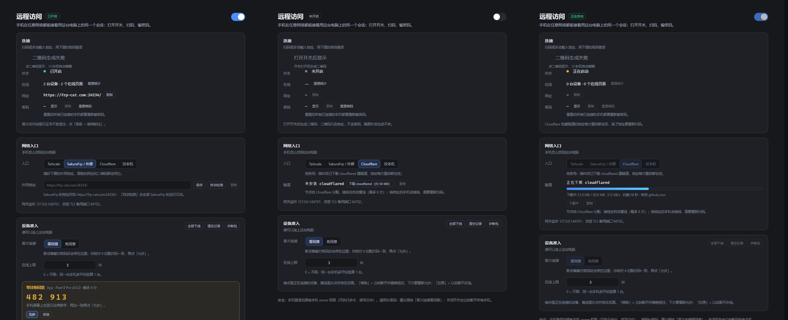

# DSH Mobile Harness（插件包名 dsh-mobile-harness）

DeepSeek Harness 插件：把「远程访问」做成应用内的一个开关，开关下面是一块小屏幕，显示网址、密码、二维码、隧道状态和连接数。

状态：**P1 + P2 完成 + 入口扩展 + 面板重排 + 下载进度条 + 网页端扫码 + 扫码也要配对码 + 连接卡重排（1.0.0，2026-10-31）**（开关、网关、二维码、扫码即登录、密码轮换、重启自动恢复；计时器实时走动；二维码默认模糊、点击显示、10 秒自动模糊、倒计时在二维码下方；在线统计按「设备 + 页面」；**手机端移动皮肤**；**四个入口：Tailscale / SakuraFrp 外部 / Cloudflare 快速隧道 / 仅本机**）。

### 面板版式（0.7.0，连接卡 0.8.4 重排）

面板从「一块小屏幕 + 一长串行」改成：hero（`远程访问` 标题 + 状态徽标 + 右侧开关 + 一句副标题）→ **三张卡**：

1. **连接**——**左列二维码（184×184）** + **右列**状态（含计时器）/ 在线（设备 + 页面 + 重置统计）/ 网址 / 密码（显示 / 复制 / 重置）/ 验证（关闭 / 开启）+ 底部提示；二维码不生成时（开关关着 / 生成失败）**不塌陷**，原位显示同尺寸虚线占位框 + 幽灵二维码 `GhostQr` + 「打开开关后显示」或「二维码生成失败」。窄屏（≤760px）回退成上下排，占位框仍在；
2. **网络入口**——入口四选一分段按钮 + 外网地址（SakuraFrp）或 Cloudflare 隧道行（**带百分比的进度条 + 速度 + 剩余时间** / 建立中 / 公网地址 / 重新连接）+ 网关端口脚注；
3. **设备准入**——首次连接（需同意 / 免同意）、在线上限、待同意卡片（放大 6 位配对码 + 二次确认）、设备行（绿点在线置顶 / 灰点离线 / 移除 / 拉黑 / 解除），右上「全部下线 / 清空记录 / 诊断包」。

「连接」卡的左右布局靠 `.dru-body{display:flex;align-items:flex-start;gap:22px}` + `.dru-body>.dru-left{flex:none;width:184px}` + `.dru-conn-right{flex:1;min-width:0}`；`.dru-body` 全文件只用于这张卡，**不要**再给它加 `flex-direction:column`（0.7.0 那条覆盖规则就是 0.8.4 修掉的塌陷根因），窄屏回退写在 `@media (max-width:760px)` 里。`.dru-fields` 另外两张卡也在用，所以 `flex:1` 只能挂在 `.dru-conn-right` 上。

### 扫码也要核对配对码（0.8.1）

浏览器和 App 走**同一套准入**（`service.admitDevice()`）：二维码里是一次性票据（`?t=`，10 分钟、命中即焚），`proxy.js` 的 `handleTicket()` 焚票后：

1. **已信任设备** → 记一次登录、302 到去掉 `t` 的地址，下发 session + device 两个 Cookie（照旧直进）；
2. **新设备** → 200 **等待页**：大号 6 位配对码 + 每 2 秒 `POST /__verify/status`；电脑面板「设备准入」待同意卡片显示同一串数字，核对一致后「允许」→「数字一致，允许」，手机/浏览器自动 `location.replace('/')`；
3. 被拒 / 超在线数 / 被拉黑 → 中文提示页（`max-online` / `denied` / `max-pending` / `blocked`）。

等待页的按钮是**「输入密码进入」**（跳 `/__login`）而不是「刷新重试」——票据已经焚了，刷新原链接回不来。**扫码不再 `autoTrust(by='qr')`**，所有新设备只能由面板确认。

说明性文字统一改成 `.dru-field-tip` / `.dru-card-desc` / `.dru-card-note` 三级灰字；待同意设备不再在设备列表里重复出现。**手机协助（P2）整段被 `const SHOW_PHONE_ASSIST = false` 隐藏**，代码保留，改 `true` 即恢复（改完记得同步 profile 并重启 DSH）。
### 网页端扫码 / 登录页 / 关闭验证（0.8.0）

浏览器从 0.3.0 起拿不到会话，面板又没有关验证的入口，所以「走隧道或 Cloudflare 都是 Unauthorized」以前是常态。0.8.0 三条路一起修：

- **一次性扫码票据**：二维码的 `qrText` 从裸地址变成 `<publicUrl>?t=<24 字符票据>`。`proxy.currentTicket()` 惰性生成（`randomBytes(18).toString('base64url')`），`TICKET_TTL_MS = 10 分钟`，面板每秒轮询会复用同一张票；`consumeTicket()` 命中即焚，`safeStopEverything()` / `rotatePassword()` 都调 `resetTicket()`。浏览器带 `?t=` 进来：票据有效 → `touchDevice` + 挡黑名单 + `registry.touch` + `autoTrust(by='qr')` + `markLogin` + 查 `onlineLimit` → **302** 到去掉 `t` 的地址并下发 session + device 两个 Cookie；票据失效 → 登录页提示「这个二维码已经用过或过期了（一次性，10 分钟）」。快照里新增 `qrTicketExpiresAt`。
- **浏览器密码登录页**：`/__login` 从死路由变成真路由。GET 返回表单（未登录访问 `/` 也是 **401 + 这个表单**，不再是纯文本 403）；POST 吃 JSON 或 urlencoded，走与 App 完全相同的准入（`admitDevice()`）：密码错 401、限流 429、黑名单 403，通过后首次设备回 **200 等待页**（大号 6 位配对码按 3 位分组 + 每 2 秒 `POST /__verify/status` 轮询，200 就 `location.replace('/')`，403 按 `denied / max-online / blocked / expired` 出中文），已信任设备直接 302 + Cookie。
- **面板「验证」行**：密码下方新增一行显示「每次新设备都要输密码 / 已关闭（免密码）」+ 按钮 **关闭验证 / 开启验证**（调 `togglePasswordProtection`，以前定义了没人引用）。关掉后 `authorizeSession` 直接放行，配对码对已信任设备不再问。

> 安全取舍：票据是一次性的，截图外发只能用一次；`?p=` 仍然彻底无效（0.3.0 起就不认）；登录页与等待页都是内联 HTML，不引用外部资源。

### 下载进度与切入口（0.7.1）

- **cloudflared 下载有进度条**：`downloadToFile` 的 progress 回调按 250ms 节流上报 `{received,total}`，`snapshot().cloudflare` 多出 `downloading / downloadPercent / downloadReceived / downloadTotal / downloadBps / downloadSource / downloadError / downloadBytes`；面板在「隧道」行下画 8px 进度条，右侧写「下载中 12.3 MB / 50.0 MB · 512 KB/s · 约剩 1 分 20 秒 · 来自 …」；服务器没给 `content-length` 时走 indeterminate 动画（不假装 0%）；失败显示「上次下载失败：<原因>」并把按钮变成「重试下载（约 50 MB）」。`installCloudflared()` 改成 fire-and-forget，POST 立刻返回，下载状态全靠 1s 轮询刷新。
- **切换入口一定先关开关**：`setTunnel(mode)` 若当前已开启（或正在切换）先 `disable()` 再落 `state.tunnel`，**不再顺带 enable**；面板发 `{tunnel, enabled:false}` 并提示「已切到「X」并自动关掉了开关」。以前 quick 模式要等 35 秒出地址，这期间面板一直「正在启动」、所有控件 disabled，看上去像卡死。
- **所有 enable/disable 走单车道**：新增 `service.serialize(run)`，`setEnabled` / `setTunnel` 排队执行；`setEnabled` 不再 `if (this.busy) return` 静默丢弃并发请求；`phaseBusy` 也算上服务端 `busy`，切换瞬间四个入口按钮会短暂变灰。

### Cloudflare 快速隧道（0.6.0，免账号）

面板「入口」新增 `Cloudflare` 按钮：不需要 Cloudflare 账号、不需要域名、不需要装 Tailscale，插件自己下 `cloudflared.exe`（约 50 MB，存 `<stateDir>/bin/`，官方 URL 失败自动换 `ghfast.top` 镜像）并起 `tunnel --url http://127.0.0.1:<网关端口>`，把 `https://<随机>.trycloudflare.com` 当作公网入口。

- 二进制按需下载：面板「隧道」行显示**百分比进度条 + 速度 + 剩余时间**；没下载时该行给「下载 cloudflared（约 50 MB）」按钮；
- 地址由 cloudflared 自己打印，插件从日志里抓；**每次重启进程地址都会变**，换完要重新扫码；
- 掉线自动重连（`2s × 2^n` 退避，最多 8 次），拿到新地址会立刻回写面板与二维码；「重新连接」按钮可手动重置；
- 关闭开关会 `taskkill /T /F` 收掉子进程，不留后台；
- 已知限制：Cloudflare 对 quick tunnel 有限流，长期稳定入口请用 SakuraFrp 或命名隧道（需要账号 + 域名）。

### 外部隧道入口（SakuraFrp / 任意 HTTPS 反代）

面板「入口」原为三选一：`Tailscale` / `SakuraFrp / 外部` / `仅本机`（0.6.0 起再加 `Cloudflare`）；以及「外网地址」输入框（保存 / 自动检测）。

- **自动检测**：读取 `C:\ProgramData\SakuraFrpService\Logs\SakuraFrpService.<日期>.log`，匹配 `使用 >>host:port<< 连接你的隧道`，并根据是否加载 `SakuraFrp Automatic TLS` 决定 `https://` 还是 `http://`；
- 切到外部入口后，面板的「网址」、二维码、`qrText` 全部使用外网地址；**二维码只编码裸地址（0.3.0 起不含密码）**，扫码后在 App 里填密码；
- SakuraFrp 会拦截 TCP 隧道里的明文 HTTP（返回 501，要求 HTTPS）。开启启动器的「HTTPS/自动 TLS」后，本地目标可保持 `127.0.0.1:64701`，frpc 负责终结 TLS；
- 插件同时保留一个自签 TLS 监听 `127.0.0.1:64702`（`lib/tls.js` 生成/复用证书），供不支持自动 TLS 的中转使用；Tailscale 入口不受影响。

实测（2026-10-27，SakuraFrp TCP 隧道 + 自动 TLS；下表端口是示例值，换成你自己的隧道端口）：

| 检查 | 结果 |
|---|---|
| `https://frp-cat.com:12345/` | 200，登录页 |
| `?p=<密码>` | **0.3.0 起 403，不再下发 Cookie**（旧行为是 303 + `dsh-gw`/`dsh-device`，已删除） |
| 带 Cookie 首页 | 200（40KB HTML） |
| `GET /api/remote.mux`（WebSocket） | 101 升级成功 |
| 静态资源 | 320KB / 0.17s ≈ 1.8MB/s；`Cache-Control: public, max-age=31536000, immutable` |
| 请求往返 | 60–100ms（Tailscale DERP 中继为 300ms） |



### 手机端移动皮肤（窄屏 ≤760px 自动启用）

桌面端是「三栏 grid」布局。手机上它有两个问题：左侧 56px 竖栏占掉聊天宽度；左栏展开时把聊天区挤到 ~110px（"页面互相挤压"）。移动皮肤（**只影响窄屏**，桌面 Electron 窗口不受影响）：

1. **隐藏 56px 左侧竖栏**，用左上角一个 34px 的 Harness 悬浮图标代替；点它展开完整侧栏抽屉。
2. 抽屉 / 右侧栏以 **fixed 覆盖层 + 半透明遮罩** 呈现，并把 shell 的 `grid-template-columns` 压成 `0 / 1fr / 0`，聊天区始终全宽（390px @ 390px 屏）。
3. 切换会话后**自动收起抽屉**；点遮罩也收起。
4. **状态行放进「对话 轨迹 …」同一行的右侧**：按文字基线对齐（实测 tab 文字中心 y=58、胶囊文字中心 y=58，不再靠盒子中心），三枚胶囊 `标准模式ᵛ · 2 智能体ᵛ · 1 后台任务ᵛ`；点「智能体/后台任务」打开下拉，点「标准模式」弹出与原生菜单同风格的说明卡片（预设会话内不可改），按下有缩放/高亮反馈。
5. **子智能体 / 后台任务下拉改为顶栏下方的整宽抽屉**：这两个原生下拉锚定在「隐藏的原 header 胶囊」上，手机上会浮空到聊天内容中间（实测芯片 y=47、菜单却出现在 y=156）。现在强制 `position:fixed; top:84px; left/right:12px`，实色表面 + 圆角 + 阴影 + `max-height:62vh` 滚动，类名 `rezYhW_menu` / `Ag-ohG_menu`；桌面端不受影响。
6. 注入 `viewport-fit=cover`，为后续装 PWA 做准备。
7. **顶栏美化**：隐藏手机上会重叠的「用资源管理器打开」按钮；顶栏改实色 + 细底边；去掉顶栏 `backdrop-filter`（它会破坏子弹出层的磨砂，导致"三点菜单透明"），弹出菜单恢复实色表面。

实现位置：`lib/client.js` 的 `installMobileSkin()`（`matchMedia('(max-width:760px)')` + `ResizeObserver`/`MutationObserver` + 一个 DOM 悬浮按钮，随插件热更新，无需重启 DSH）。

### 在线统计口径

之前显示的数字是 **TCP socket 数**（一个页面会开很多条连接，测试时还会更多），所以看起来像"十几台设备"。

现在：

- **设备**：登录时下发一个随机 `dsh-device` Cookie（HttpOnly，一年有效），按 Cookie 去重；没有打开页面时，最后一次请求后 60 秒内仍算在线。
- **在线页面**：统计 `/api/remote.mux` 的 WebSocket 数量——每个打开的 DSH 页面正好一条，关闭即减。
- 面板显示为 `1 台设备 · 1 个在线页面`；计数逻辑有独立回归测试（开发工作区里的 `test-proxy-count.mjs`）。

### 设备准入与配对码（0.4.0 / 0.4.3 / 0.3.0 插件）

- **待同意弹窗（0.3.0）**：配对卡除了长在「远程 → 设备准入」里，还注册到 `shell.overlay`，直接浮在 DSH 窗口最上层（每 1.5s 轮询 status；可「稍后」2 分钟 / 拒绝 / 允许→二次确认），不用切面板也能放行；
- **删除 `?p=` 链接直通（0.3.0）**：Url 里带密码不再能换会话（`/?p=goodpass` → 403，无 `set-cookie`），二维码只编码裸地址；会话只能由 App 的 `POST /__verify` + 配对码换来。

- 状态机：`unknown --密码--> pending --允许--> trusted`；`pending --拒绝/超时--> revoked`；`trusted --移除--> revoked`；任意 --拉黑--> blocked（`lib/registry.js`）；
- 新设备第一眼只能拿到 **202 待同意**：面板「设备准入」出现待同意卡片，手机显示「等待电脑确认」；
- **配对码（0.4.3）**：每个待同意请求带 6 位 `pairCode`（`registry.js` 的 `randomPairingCode`，去重）；手机等待页与电脑卡片显示同一串，用户核对一致后点「允许」→「数字一致，允许」，approve 会带 `code` 回传，`service.js` 校验不一致即 400。字段名必须叫 `pairCode`，不能复用 202 里已有的 `code:"pending"`；
- 最大在线设备数、待同意上限 3、5 分钟过期、拒绝去抖、失败限流都在 `registry.js` / `proxy.js`；面板开关走 `POST /api/dsh-mobile-harness.devices`。

## 用法

1. 安装（自动写入 profile 的 bundles）：
   ```powershell
   dsh plugin --profile desktop add "file:<repo>/plugins/dsh-mobile-harness"
   ```
   或者在本仓库里运行 `node scripts/install-plugin.mjs --profile desktop`（会自动写好依赖与 bundles）。
2. 不要再用 `start-dsh-remote.cmd`（两者都占用 Tailscale 80）；正常启动 DSH。
3. 侧栏点「远程」→ 打开开关 → 手机 Tailscale 扫码进入。
4. 关闭开关即断开所有手机；重置密码会让所有设备重新登录。

## 结构

| 文件 | 作用 |
|---|---|
| `lib/index.js` | 宿主入口：生命周期 + 鉴权路由（status / toggle / password / external / devices / cloudflared） |
| `lib/service.js` | 状态机：启停、持久化、状态快照、密码轮换 |
| `lib/proxy.js` | 本机密码网关：`/__verify` + 配对码、Cookie 注入、Host/Origin 改写、WS 中继（`?p=` 直通已删） |
| `lib/tailscale.js` | `tailscale status / serve --http=80 / serve off` 封装 |
| `lib/state.js` | `~/.dsh/remote-access/plugin-state.json`（开关、密码、会话密钥、端口） |
| `lib/qr.js` + `lib/qr-encoder.cjs` | 内置 MIT QR 编码器，宿主输出矩阵、客户端画 SVG |
| `lib/client.js` | 浏览器半边：`sidebar.panellist` 图标 + `main` 页面 + `shell.overlay` 配对弹窗 |
| `cordis.patch.yml` | 往 profile 插入一行宿主插件 |

## 设计约束

- 浏览器半边是纯 JS（只 require `react`/`react-dom`），不依赖构建；
- 所有宿主路由走 `ctx.connection.fetch.register`，自动复用 DSH 的 owner 鉴权；
- 手机看不到 DSH 的 owner Cookie：网关自己保管并注入；
- 与外部 `start-dsh-remote.cmd` 状态目录分开（插件用 `plugin-state.json`，脚本用 `state.json`），可共存但**不要同时启用**。

